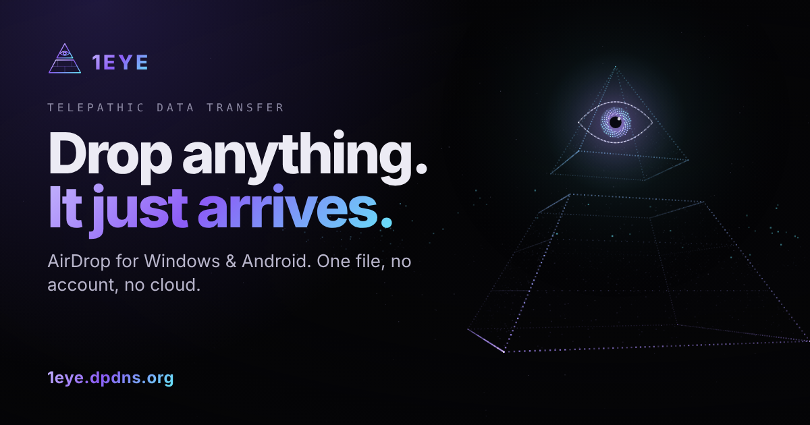
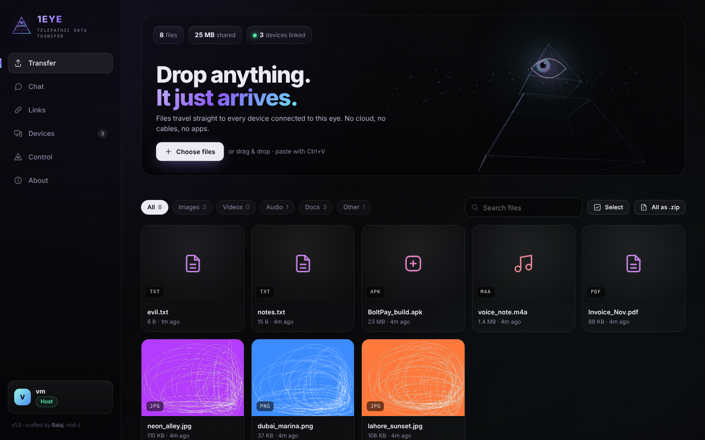
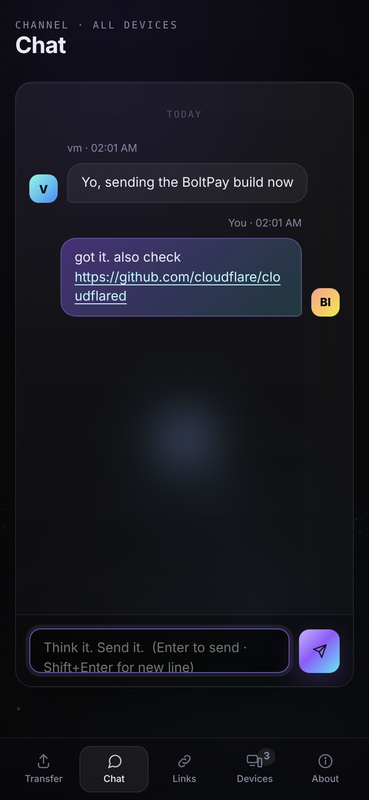

<p align="center"></p>

<h1 align="center">1EYE — Telepathic Data Transfer</h1>

<p align="center"><b>AirDrop for Windows and Android.</b> Send files, chat and links between your phone and PC.<br>One 7 MB file. No account. No cloud.</p>

<p align="center">
  <a href="https://1eye.dpdns.org"><b>Website</b></a> ·
  <a href="releases/1EYE-Windows-v1.5.zip"><b>Download for Windows</b></a> ·
  <a href="releases/1EYE-Android-v1.5.apk"><b>Download for Android</b></a> ·
  <a href="releases/SHA256SUMS.txt">Checksums</a>
</p>

---

## What it does

- **Files of any size**: drag, drop or paste. Uploads stream straight to disk with live speed. Preview photos, video, audio, PDFs and text, or grab everything as a zip.
- **Chat**: a private, live channel between your own devices. Any link you send is saved automatically.
- **Links shelf**: one place for every URL you want open on another screen.
- **Wi-Fi or anywhere**: instant on your local network. One click opens a secure HTTPS link that works from any network (Cloudflare, localhost.run or Pinggy, with automatic fallback). You can also point your own domain at it permanently.
- **Your phone can be the host**: the Android app runs the same server. Share → 1EYE from any app drops files straight in.
- **The look**: an interactive 3D particle eye, a glassy dark UI, and a layout that works on desktop and mobile.

<p align="center"> </p>

## How it works

1. Run `1EYE.exe` on Windows (or open the Android app). The control panel opens with a QR code and a 6-digit PIN.
2. Scan the QR code with any phone or laptop on the same Wi-Fi, enter the PIN and name the device.
3. Drop files, send messages and save links. Everything shows up on every linked device instantly.
4. Away from home? In **Control → Anywhere**, press **Go online** for a link that works from any network.

## Security

- No 1EYE servers: files go directly between your devices and are stored in a `1EYE_Shared` folder next to the app.
- A 6-digit PIN, rate-limited (5 wrong tries = 5-minute block), protects every connection. The host can kick any device or rotate the PIN.
- Host controls only answer on the host machine itself (loopback), never over Wi-Fi or a tunnel.
- Internet traffic enters through a separate loopback-only entry point and is always treated as untrusted.
- Cross-site requests are blocked (CSRF), and requests addressed to anything but `localhost` lose host powers (DNS rebinding).

Found a problem? Please open an issue.

## Windows says "Unknown publisher"

1EYE isn't code-signed yet, so SmartScreen may warn you. Click **More info → Run anyway**. You can check the download against [SHA256SUMS.txt](releases/SHA256SUMS.txt) or build it yourself.

## Build from source

```bash
# Desktop (needs Go 1.24+): Windows, Linux, macOS and the Android server binaries
cd desktop && ./build.sh

# Android APK (no Android Studio needed; see the variables at the top of the script)
cd android && ./build.sh
```

- `desktop/`: the Go server and the embedded web app (`web/`)
- `android/`: a small Java wrapper (foreground service + WebView) that runs the same Go server
- `website/`: the landing page at 1eye.dpdns.org

## Credits

Made by **Balaj** in Lahore. Rolled one, lit it, and somewhere around the middle of that J decided he needed this service for himself. Why? idk. Lame.

MIT licensed.
